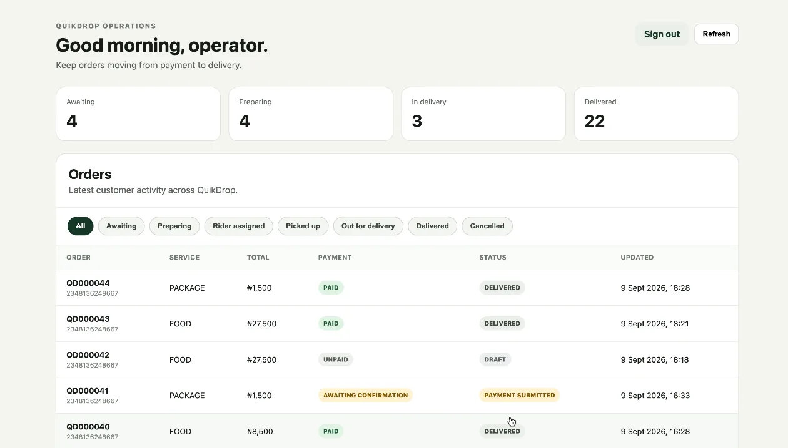

# QuikDrop
### WhatsApp food and package delivery automation

A working MVP using WhatsApp as the customer-facing interface for food orders and package-delivery requests, with an operations dashboard for reviewing and coordinating the work.

**Status:** Working MVP. The current workflow is rule-based. An LLM-assisted layer is planned, not shipped.

**Case study:** https://jaytee-automation-engineer.vercel.app/work/quickdrop

## Reported outcome

The reported daily operating result moved from roughly **95–120 successful orders to about 195 out of approximately 200 orders per day**. This is a project-reported operating result, not an independently audited benchmark.

## What it does

- Receives requests through the Meta WhatsApp Cloud API.
- Converts incoming messages into structured order information.
- Validates required details before an order proceeds.
- Maintains order and delivery state in Supabase/PostgreSQL.
- Coordinates operator review, payment-verification checkpoints, availability exceptions and rider handoffs.
- Sends customer-facing status updates through WhatsApp.
- Preserves human fallback for exceptions and operational overrides.

## Architecture

See [docs/architecture.md](docs/architecture.md) for the full flow diagram.

The current implementation uses deterministic rules and explicit workflow state. The planned LLM layer is intended to help interpret less structured messages; it is not part of the shipped workflow and must not bypass validation or human approval.

## Screenshots

**Customer conversation problem framing**

**Operator workflow layer**

These visuals are presentation assets from the public portfolio case study, not customer records.

## Technology

Meta WhatsApp Cloud API · Webhooks · JavaScript / TypeScript · Supabase Edge Functions · Supabase / PostgreSQL · Operations dashboard

## Human control and limitations

Payment verification, availability exceptions and operational overrides remain human-controlled. This repository documents the system and its architecture; it does not contain private application source, credentials, customer data or production secrets.

The LLM layer is a future enhancement, not an implemented capability. Do not interpret the reported daily order result as evidence of fully autonomous fulfillment.

[Full case study](https://jaytee-automation-engineer.vercel.app/work/quickdrop) · [Portfolio](https://jaytee-automation-engineer.vercel.app/)
