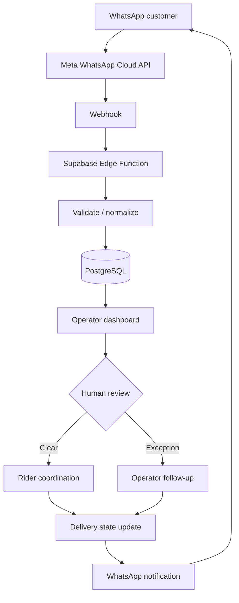

# QuikDrop architecture

QuikDrop is a rule-based WhatsApp ordering and delivery-coordination MVP.

## Event path

1. A customer sends a food or package request through WhatsApp.
2. Meta WhatsApp Cloud API forwards the event to a webhook.
3. A Supabase Edge Function validates and normalizes the message.
4. The workflow stores structured order state in PostgreSQL.
5. The operator dashboard exposes the order and any required human checkpoints.
6. An operator verifies payment or availability, resolves exceptions and coordinates rider handoff.
7. Status changes are reflected in the customer conversation.

## System boundary

- **Deterministic logic:** validation, required fields, order state and permitted transitions.
- **Human decisions:** payment verification, availability exceptions and operational overrides.
- **Planned only:** an LLM-assisted interpretation layer for less structured requests. It is not in the shipped workflow.

## Diagram

